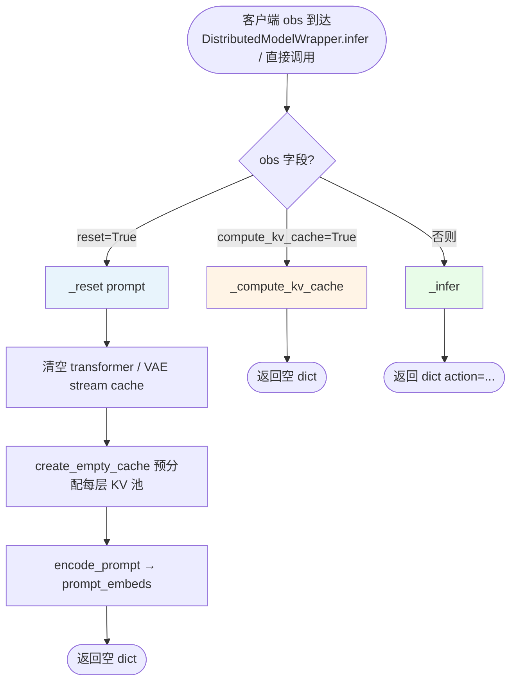
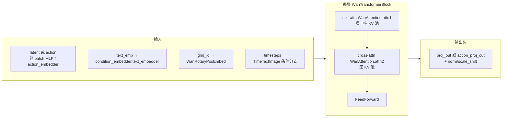

# Lingbot-VA（wan_va）推理流程与 KV Cache 说明

本文档梳理 **lingbot-VA** 在 `wan_va` 模块中的推理数据流、关键源码位置，以及 **自定义 KV 池**（非 HuggingFace `past_key_values`）的生成、写入与生命周期，供模型推理加速与 profiling 时对齐代码路径。

---

## 1. 建议优先关注的文件

| 角色 | 路径 |
|------|------|
| **总控：观测 → VAE → 扩散循环 → 动作后处理** | `wan_va/wan_va_server.py`（`VA_Server`） |
| **Transformer + 每层 self-attn 的 KV 池** | `wan_va/modules/model.py`（`WanAttention`、`WanTransformerBlock`、`WanTransformer3DModel`） |
| **VAE / Transformer / T5 加载** | `wan_va/modules/utils.py` |
| **RoPE 网格 ID、latent patch 还原** | `wan_va/utils/utils.py`（`get_mesh_id`、`data_seq_to_patch`） |
| **多卡广播 + WebSocket 封装** | `wan_va/utils/sever_utils.py`、`wan_va/utils/Simple_Remote_Infer/deploy/websocket_policy_server.py` |
| **FSDP / 设备配置** | `wan_va/distributed/fsdp.py`、`wan_va/distributed/util.py` |
| **RobotWin 评估侧调用 `infer`（含 `compute_kv_cache`）** | `evaluation/robotwin/eval_polict_client_openpi.py` |
| **训练前向（FlexAttn mask，不走 KV 池）** | `wan_va/modules/model.py` → `forward_train` |

> **说明**：仓库内 `flash-attention-2.8.3/` 为依赖/参考实现。当前 Wan 推理路径中 **未直接使用** `flash_attn_with_kvcache` 一类的 API；KV 在 `WanAttention` 内用 Tensor 池维护，再组 batch 维的 `key`/`value` 调用 `flash_attn_func` 或 `custom_sdpa`。

---

## 2. `VA_Server.infer` 请求分发（控制流）

客户端每次请求携带字典 `obs`，由 `infer` 按字段分支：



**数据含义（粗体为 obs 键）：**

| 分支 | 主要输入 | 主要输出 |
|------|----------|----------|
| `reset` | **prompt**（可选） | 无业务张量；服务端状态归零并编码文本 |
| `compute_kv_cache` | **obs**（多机位图）、**state**（已执行动作） | 无；向 GPU KV 池写入「条件」侧 K/V |
| 默认 | **obs**、内部 `frame_st_id` 等 | **action**（numpy，反归一化后） |

---

## 3. 端到端数据流（Server 模式，含数据形态标注）

下图按 **时间顺序** 展开：`reset` 后，评估循环中往往交替执行 **KV 预填** 与 **本 chunk 扩散推理**。

```mermaid
flowchart TB
  subgraph RESET["① reset：环境与文本条件"]
    direction TB
    T0[任务 prompt 字符串]
    TK[T5 Tokenizer]
    TE[T5 Encoder UMT5EncoderModel]
    PE[(VA_Server.prompt_embeds<br/>+ 可选 negative 用于 CFG)]
    T0 -->|text| TK -->|input_ids, mask| TE
    TE -->|float 序列 [B,L,D]| PE
    RS1[transformer.clear_cache]
    RS2[create_empty_cache<br/>按 attn_window × token/chunk 定 total_tolen]
    RS3[streaming_vae.clear_cache]
    RS1 --> RS2 --> RS3
  end

  subgraph OBS["② 观测编码：图像 → latent"]
    direction TB
    IMG[obs.obs：按 obs_cam_keys 的多路<br/>RGB uint8 / float，时间维堆叠]
    RJ[resize / 归一化到 -1,1]
    VAE[WanVAEStreamingWrapper.encode_chunk]
    LAT[video_latent<br/>形状约 B×C×F×H'×W'<br/>已用 VAE mean/std 归一]
    IMG --> RJ --> VAE --> LAT
  end

  subgraph PREP["③ 组装 transformer 输入 dict"]
    direction TB
    GI[get_mesh_id：时空网格 ID<br/>f_shift=frame_st_id 对齐 chunk]
    TS[timesteps：与外扩循环 t 对齐的标量张量]
    DICT_L["latent_res_lst：<br/>noisy_latents, timesteps,<br/>grid_id, text_emb"]
    DICT_A["action_res_lst：<br/>同上，action_embedder 分支"]
    GI --> DICT_L
    TS --> DICT_L
    PE --> DICT_L
    TS --> DICT_A
    PE --> DICT_A
    ACT[state：numpy → preprocess_action<br/>量化归一 → B×C×F×H×1]
    ACT --> DICT_A
  end

  subgraph KVC["④ compute_kv_cache 分支"]
    direction TB
    CLR[clear_pred_cache：释放 is_pred 槽<br/>保留条件槽]
    LAT2[_encode_obs 或拼接 init_latent]
    CLR --> LAT2 --> PREP
    F1["transformer(..., action_mode=False,<br/>update_cache=2)"]
    F2["transformer(..., action_mode=True,<br/>update_cache=2)"]
    PREP --> F1
    F1 --> F2
    F2 --> FID[frame_st_id += 当前 chunk 帧数 F]
  end

  subgraph DIF["⑤ _infer：视频 + 动作扩散"]
    direction TB
    ZN[randn 初始化 latents / actions]
    LOOP_V["for t in video_timesteps：<br/>准备 latent 条件首帧等"]
    TV["transformer 视频分支<br/>中间步 update_cache=0<br/>末步 update_cache=1"]
    SV[FlowMatchScheduler.step → 更新 latents]
    LOOP_V --> TV --> SV
    LOOP_A["for t in action_timesteps：同理"]
    TA["transformer 动作分支<br/>同样 0 / 1 切换"]
    SA[action_scheduler.step]
    LOOP_A --> TA --> SA
    POST[postprocess_action：反量化 → numpy]
    SV --> LOOP_A
    SA --> POST
  end

  RESET -.->|"首次后"| OBS
  OBS --> PREP
  PREP --> KVC
  PREP --> DIF
```

**读图要点：**

- **实线向下**：主数据依赖；**文本嵌入 `prompt_embeds`** 同时进入 KV 预填与扩散两个阶段。
- **`video_latent`**：来自 VAE，作为条件或 `_compute_kv_cache` 中 `noisy_latents` 的语义载体（与训练时 noisy/cond 命名继承一致）。
- **`update_cache`**：控制当前步 K/V 是否 **长期占用槽位**，见第 4 节；扩散中间步为 `0`，该段最后一步为 `1`；KV 预填统一为 `2`。

---

## 4. `WanTransformer3DModel.forward` 内部（推理路径）

推理时 `train_mode=False`，逐层 `WanTransformerBlock`：



- **数据流**：`hidden_states` 在 self-attn 后与 **KV 池中已占用槽位** 的 K/V 做注意力（见下节）；cross-attn 每步从 `text_hidden_states` 读 K/V，**不写入** 自定义 KV 池。

---

## 5. KV Cache：结构、`update_cache` 语义与存储位置

### 5.1 池子结构（每层、仅 `attn1`）

在 `init_kv_cache` 中创建：

| 字段 | 含义 |
|------|------|
| `k`, `v` | `[batch_size, total_tolen, num_heads, head_dim]`，GPU Tensor |
| `id` | 槽位逻辑顺序，用于 **槽满时按序淘汰** |
| `mask` | 槽是否占用 |
| `is_pred` | 是否为 **扩散末步预测** 写入（与条件写入区分） |

`total_tolen` 由 `create_empty_cache` 计算：

\[
\text{total\_tolen} = \frac{\texttt{attn\_window}}{2} \times N_{\text{latent/token/chunk}} + \frac{\texttt{attn\_window}}{2} \times N_{\text{action/token/chunk}}
\]

### 5.2 单步 `WanAttention.forward` 与数据流

```mermaid
flowchart TD
  QKV[Q,K,V 线性 + RMSNorm + RoPE] --> UC{kv_cache 已创建?}
  UC -->|否| ATT0[attn_op Q,K,V]
  UC -->|是| ALLOC[allocate_slots：不够则按 id 回收最旧槽]
  ALLOC --> WRITE[写入当前步 K,V 到槽位<br/>is_pred = update_cache==1]
  WRITE --> GATHER[key = k_pool[:, valid]<br/>value = v_pool[:, valid]<br/>valid = mask 为 True 的下标]
  GATHER --> ATT[attn_op query, key, value]
  ATT --> RST{update_cache == 0 ?}
  RST -->|是| REST[restore_cache：本步槽释放<br/>不保留到下一步]
  RST -->|否| KEEP[本步槽保持占用]
  ATT0 --> OUT[Linear + Dropout 输出]
  REST --> OUT
  KEEP --> OUT
```

### 5.3 `update_cache` 取值（与 `wan_va_server` 对齐）

| 值 | `is_pred` | 扩散结束是否 `restore_cache` | 语义 |
|----|-----------|------------------------------|------|
| **0** | `False`（因仅 `==1` 为 pred） | **是** | 临时写入：本步为算 attention 用，**算完释放槽** |
| **1** | `True` | 否 | 该分支（视频/动作）**当前段最后一步**：K/V **保留**，标为预测侧 |
| **2** | `False` | 否 | **观测 + 已执行动作** 预填：条件侧 K/V **长期保留**（直到淘汰或 `clear_pred_cache` / `clear_cache`） |

**`clear_pred_cache`**：将 `is_pred==True` 的槽 **`mask` 清零**，保留条件槽，便于下一 chunk 只清「上一段扩散残留」而不清空真实历史。

**持久化**：KV **仅存 GPU**，无单独磁盘序列化；若见 `save_async` 写 `.pt`，多为 latents/actions/obs 调试，**不是** KV 张量。

---

## 6. 推理加速时可关注的代码点

1. **算子热点**：30× `WanAttention.attn_op`（Flash / PyTorch SDPA），以及 **`k_pool[:, valid]` 索引** 在 `valid` 长度变化时的 gather 开销。
2. **调度语义**：修改「仅末步 `update_cache=1`」会改变池中 token 数量与 attention 代价。
3. **CFG**：`batch_size=2` 时 KV 池 batch 维为 2，显存与算力近似翻倍。
4. **多卡**：`sever_utils.worker_loop` 与 rank0 必须执行同一 `infer` 序列，避免 KV 与参数分片不一致。
5. **其他 policy**：`RoboTwin/policy/` 下 RDT、π₀ 等 **不走** 本 KV 机制；VA 加速应锚定 `wan_va/`。

---

## 7. 修订记录

- 文档首版：整理自 `wan_va_server.py`、`modules/model.py` 等当前实现，流程图带数据流标注便于与代码对照。
